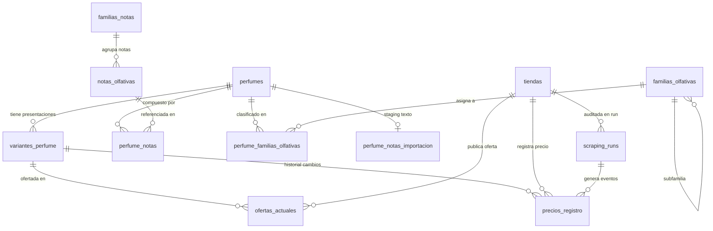

# PerfumeTrending.cl — Especificación del Modelo Relacional
**Arquitectura de Datos PostgreSQL 15+ / Supabase y SQLite Contingencia**

---

## 1. Diagrama de Entidad-Relación y Capas de Dominio

El modelo separa nítidamente:
1. **Catálogo Maestro y Variantes:** El perfume conceptual (`perfumes`) frente a la presentación específica o SKU (`variantes_perfume`).
2. **Directorio Comercial y Ofertas Vivas:** Las tiendas auditadas (`tiendas`) y la fotografía viva de precios/stock por tienda y variante (`ofertas_actuales`).
3. **Historial Inmutable de Cambios:** Línea de tiempo de eventos confirmados (`precios_registro`) vinculada a observaciones y auditoría de ETL (`scraping_runs`).
4. **Catálogo Canónico de Notas y Familias Olfativas:** Taxonomía de 12 familias de notas y 107 notas normalizadas (`familias_notas`, `notas_olfativas`, `perfume_notas`), y familias olfativas generales (`familias_olfativas`, `perfume_familias_olfativas`).
5. **Staging de Migración Olfativa:** Preservación del texto original para control de calidad (`perfume_notas_importacion`).

---

## 2. Definición Detallada de Entidades y Restricciones

### 2.1. `perfumes` (Producto Maestro Conceptual)
- **Propósito:** Representa la identidad abstracta de una fragancia (ej. *Bleu de Chanel*, *YSL Libre*). No contiene volumen ni stock, ya que estos varían por presentación y tienda.
- **Campos:** `id` (PK), `nombre`, `marca`, `genero`, `tipo`, `notas` (conservado por compatibilidad), `imagen_url`, `es_arabe`, `en_tendencia`, `en_remate`, `precio_referencia`, `created_at`.
- **Regla:** Nunca se fusionan perfumes por similitud parcial de texto.

### 2.2. `variantes_perfume` (Presentación / SKU Físico)
- **Propósito:** Especifica una presentación concreta con volumen, concentración y formato.
- **Campos:**
  - `id`: BIGINT GENERATED BY DEFAULT AS IDENTITY PRIMARY KEY
  - `perfume_id`: BIGINT NOT NULL REFERENCES `perfumes(id)` ON DELETE RESTRICT
  - `concentracion`: TEXT (ej. 'EDP', 'EDT', 'Parfum', 'Elixir')
  - `volumen_ml`: NUMERIC(8,2) CHECK (volumen_ml IS NULL OR volumen_ml > 0)
  - `formato`: TEXT NOT NULL DEFAULT 'regular' CHECK (length(trim(formato)) > 0) (ej. 'regular', 'tester', 'set', 'recarga')
  - `identificador_externo`: TEXT (SKU o código de barras si está disponible)
  - `slug`: TEXT UNIQUE
  - `activa`: BOOLEAN NOT NULL DEFAULT true
  - `created_at`, `updated_at`: TIMESTAMPTZ

### 2.3. `ofertas_actuales` (Snapshot de Ofertas Vivas)
- **Propósito:** Almacena el estado actual confirmado de una variante en una tienda dada.
- **Cardinalidad:** Máximo 1 oferta por `(variante_id, tienda_id)`.
- **Restricción Unívoca:** `UNIQUE (variante_id, tienda_id)`
- **Campos Clave:**
  - `precio_actual`: INTEGER CHECK (precio_actual IS NULL OR precio_actual > 0)
  - `precio_normal`: INTEGER CHECK (precio_normal IS NULL OR precio_normal > 0)
  - `en_stock`: BOOLEAN (NULL indica stock desconocido; jamás default true o false)
  - `url_producto`: TEXT
  - `estado`: TEXT ('activa', 'agotada', 'no_verificada', 'retirada', 'requiere_revision')
  - `ultima_verificacion_exitosa`: TIMESTAMPTZ
  - `ultimo_intento`: TIMESTAMPTZ
  - `ultimo_cambio_confirmado`: TIMESTAMPTZ
  - `fallos_consecutivos`: INTEGER DEFAULT 0 CHECK (fallos_consecutivos >= 0)
  - `ultimo_error`: TEXT

### 2.4. `precios_registro` (Línea de Tiempo Inmutable de Eventos)
- **Propósito:** Registra la primera observación válida y cada cambio confirmado de precio, stock o URL.
- **Ampliación Aditiva:**
  - `variante_id`: BIGINT REFERENCES `variantes_perfume(id)`
  - `tipo_evento`: TEXT ('observacion_inicial', 'cambio_precio', 'cambio_stock', 'cambio_url', 'cambio_multiple')
  - `campos_modificados`: TEXT[] (lista de atributos que cambiaron)
  - `observacion_id`: UUID (identificador unívoco de la captura)
  - `scraping_run_id`: BIGINT REFERENCES `scraping_runs(id)`

### 2.5. `scraping_runs` (Auditoría de Ingestas y ETL)
- **Propósito:** Registra cada ejecución del bot, volumen procesado, métricas de cambios y errores.
- **Campos:** `id`, `tipo_scraper`, `tienda_id`, `estado`, `fecha_inicio`, `fecha_fin`, `productos_procesados`, `ofertas_nuevas`, `cambios_precio`, `cambios_stock`, `cambios_url`, `errores`, `mensaje_detalle`.

### 2.6. Catálogo Canónico Olfativo
- `familias_notas`: 12 familias oficiales con orden, slug, nombre y emoji.
- `notas_olfativas`: 107 notas canónicas con slug, sinónimos (`TEXT[]` con índice GIN) y pertenencia a familia.
- `perfume_notas`: Relación perfume-nota indicando `etapa` ('salida', 'corazon', 'fondo', 'desconocida'), `fuente_tipo`, `confianza` (0-100) y `verificada`. Restricción `UNIQUE (perfume_id, nota_id, etapa)`.
- `familias_olfativas` y `perfume_familias_olfativas`: Clasificación macro editorial (máximo 1 familia principal con índice único parcial).
- `perfume_notas_importacion`: Staging que preserva el texto original de `perfumes.notas` para auditar el mapeo.
