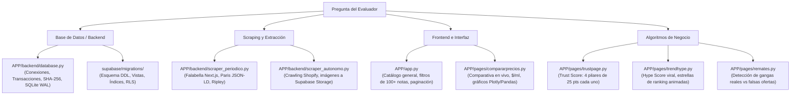

# 🎓 Guía Maestra de Defensa — PerfumeTrending.cl (APT122)

Documento ejecutivo de consulta rápida para la presentación oral y defensa técnica del proyecto ante la comisión evaluadora.

---

## 📌 1. Ficha Resumen del Proyecto

| Dimensión | Detalle Técnico |
| :--- | :--- |
| **Nombre del Proyecto** | **PerfumeTrending.cl** — Plataforma Inteligente de Comparación de Precios, Detección de Tendencias y Verificación Antifraude |
| **Arquitectura de Software** | MVC Desacoplado con Single Page Application (Streamlit) + Capa de Persistencia Híbrida Cloud/Local |
| **Base de Datos Primaria (Cloud)** | **Supabase (PostgreSQL 15+)** con 6 Vistas SQL optimizadas, RLS (Row Level Security) y Funciones Almacenadas (RPC) |
| **Base de Datos de Resiliencia** | **SQLite local con modo WAL (Write-Ahead Logging)** para contingencia Zero-Downtime |
| **Motor de Extracción (Scraping)** | Extracción estructurada: Hidratación Next.js (`__NEXT_DATA__`), Schema.org JSON-LD, APIs Shopify públicas y DOM parsing con BeautifulSoup |
| **Seguridad de Usuarios** | Hashing criptográfico unidireccional SHA-256, sin almacenamiento de claves en texto plano |
| **Métricas de Valor al Consumidor** | Normalización de costo por mililitro (**$/ml**), TrustScore de 4 pilares (0-100 pts) y Hype Score de viralidad |

---

## 🗺️ 2. Mapa Rápido: Qué Archivo Abrir Según la Pregunta de la Comisión

Si un profesor te dice: *"Ábreme el código de..."*, ve directamente a estos archivos:

---

## 💬 3. Respuestas Clave a las Preguntas Más Frecuentes

### 1. "¿Por qué tienen Supabase y SQLite al mismo tiempo?"
> *"Implementamos un patrón de **Alta Disponibilidad y Resiliencia Defensiva (Zero-Downtime Fallback)**. En producción, la aplicación consulta Supabase en la nube (PostgreSQL 15), aprovechando vistas SQL precalculadas e índices B-Tree. Sin embargo, si la conexión a internet falla o el servicio en la nube tiene latencia, el sistema conmuta automáticamente a la base de datos local SQLite sin que el usuario experimente caídas de servicio ni pantallas de error."*
> **Archivo a mostrar:** [APP/backend/database.py](file:///c:/Users/ponch/Downloads/AhabAssistantLimbusCompany-main/PerfumeTrending.cl/APP/backend/database.py#L170-L220) (`is_supabase_disponible()` y `get_connection()`).

---

### 2. "¿Cómo evitan que SQLite se bloquee cuando el scraper escribe y un usuario lee?"
> *"Activamos el modo **WAL (Write-Ahead Logging)** mediante `PRAGMA journal_mode=WAL;`. A diferencia del modo tradicional de SQLite que bloquea toda la base de datos durante las escrituras, WAL permite que múltiples lectores concurrentes lean el catálogo mientras el proceso de scraping escribe transaccionalmente en segundo plano."*
> **Archivo a mostrar:** [APP/backend/database.py](file:///c:/Users/ponch/Downloads/AhabAssistantLimbusCompany-main/PerfumeTrending.cl/APP/backend/database.py#L195-L220) (`get_connection()`).

---

### 3. "¿Cómo extraen los precios sin que las tiendas los bloqueen o rompan el HTML?"
> *"No dependemos únicamente de selectores CSS frágiles que cambian con frecuencia. Empleamos tres técnicas avanzadas de ingeniería inversa de datos:*
> 1. ***Falabella:*** *Inspeccionamos el estado de hidratación de Next.js (`__NEXT_DATA__`), obteniendo el JSON puro que el servidor entrega a React antes del renderizado.*
> 2. ***Paris:*** *Extraemos los metadatos estructurados oficiales bajo el estándar semántico **Schema.org JSON-LD** (`Offers`, `price`, `availability`).*
> 3. ***Silk y Elite Perfumes:*** *Consumimos directamente sus endpoints públicos de catálogo Shopify (`/products.json`).*
> 4. ***Políticas Anti-bloqueo:*** *Headers rotativos de navegador real, connection pooling y backoff exponencial ante respuestas 429/5xx."*
> **Archivo a mostrar:** [APP/backend/scraper_periodico.py](file:///c:/Users/ponch/Downloads/AhabAssistantLimbusCompany-main/PerfumeTrending.cl/APP/backend/scraper_periodico.py) y [APP/backend/scraper_autonomo.py](file:///c:/Users/ponch/Downloads/AhabAssistantLimbusCompany-main/PerfumeTrending.cl/APP/backend/scraper_autonomo.py).

---

### 4. "¿Cómo aseguran que no se inserten precios erróneos o falsos cuando un scraper falla?"
> *"A través de la función transaccional atómica `registrar_observacion_oferta()` y `registrar_fallo_scraping()`. Si una tienda devuelve error 404/500 o timeout, **nunca inventamos un precio ni destruimos el precio confirmado anterior**; simplemente incrementamos el contador `fallos_consecutivos` y registramos el mensaje de error para observabilidad. Solo actualizamos el precio vivo si recibimos un precio entero positivo estrictamente validado y un stock booleano explícito."*
> **Archivo a mostrar:** [APP/backend/database.py](file:///c:/Users/ponch/Downloads/AhabAssistantLimbusCompany-main/PerfumeTrending.cl/APP/backend/database.py#L870-L950) y [test_persistencia_transaccional.py](file:///c:/Users/ponch/Downloads/AhabAssistantLimbusCompany-main/PerfumeTrending.cl/tests/test_persistencia_transaccional.py).

---

### 5. "¿Cómo funciona el Trust Score y qué valor le entrega a los chilenos?"
> *"El mercado de perfumería en Chile tiene un alto índice de falsificaciones y estafas en redes sociales. Nuestro Trust Score evalúa a los comercios de 0 a 100 puntos en 4 pilares auditados de 25 puntos cada uno:*
> 1. ***Seguridad Web (25 pts):*** *Certificado SSL/TLS válido con protocolo HTTPS.*
> 2. ***Legalidad Comercial (25 pts):*** *Razón social constituida y RUT verificable ante el Servicio de Impuestos Internos (SII).*
> 3. ***Garantía al Consumidor (25 pts):*** *Cumplimiento de la Ley 19.496, política de devolución de 30 días y boleta oficial.*
> 4. ***Reputación y Sellos (25 pts):*** *Adhesión a la Cámara de Comercio de Santiago (CCS) y bajo índice de reclamos en el SERNAC."*
> **Archivo a mostrar:** [APP/pages/trustpage.py](file:///c:/Users/ponch/Downloads/AhabAssistantLimbusCompany-main/PerfumeTrending.cl/APP/pages/trustpage.py) y [database.py: auditar_tienda_por_url](file:///c:/Users/ponch/Downloads/AhabAssistantLimbusCompany-main/PerfumeTrending.cl/APP/backend/database.py).

---

### 6. "¿Por qué calculan el precio por mililitro ($/ml)?"
> *"Porque comparar el precio absoluto entre distintas presentaciones es engañoso: un perfume de 50ml a $60.000 cuesta $1.200/ml, mientras que uno de 100ml a $90.000 cuesta $900/ml (es más económico por unidad de volumen). El comparador calcula automáticamente `$ / volumen_ml` para que el consumidor tome la decisión más conveniente."*
> **Archivo a mostrar:** [APP/pages/compararprecios.py](file:///c:/Users/ponch/Downloads/AhabAssistantLimbusCompany-main/PerfumeTrending.cl/APP/pages/compararprecios.py#L920-L940).

---

## 🎯 4. Orden Recomendado para la Demostración en Vivo

1. **Apertura (Home `app.py`):**
   - Mostrar la barra de búsqueda y filtrar en vivo escribiendo *"Bleu"* o *"Sauvage"*.
   - Abrir el popover de **Esencias** y marcar *"Vainilla"* o *"Oud"* para demostrar cómo se filtran los perfumes en tiempo real gracias al caché en memoria.
2. **Comparador (`compararprecios.py`):**
   - Seleccionar un perfume popular.
   - Destacar la tarjeta con el distintivo verde **"MEJOR PRECIO"**, el cálculo de **$/ml**, el botón *"Ir a la oferta"* y desplegar el gráfico de evolución temporal de precios.
3. **Página de Confianza (`trustpage.py`):**
   - Explicar la tabla con Falabella, Paris, Silk, Elite (Verificados con RUT y SERNAC) y la fila de alerta de vendedores no autorizados (38/100, ALTO RIESGO).
4. **Radar de Tendencias (`trendhype.py`):**
   - Mostrar el ranking con estrellas animadas (Bleu de Chanel #1, YSL Libre #2) y la explicación semántica generada por IA sobre por qué se volvieron virales.
5. **Cierre Técnico:**
   - Si los evaluadores piden ver arquitectura, mostrar las migraciones SQL en Supabase (`security_invoker` views) y la suite de pruebas unitarias (`python -m unittest discover tests`).
